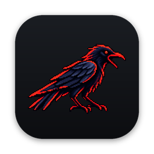
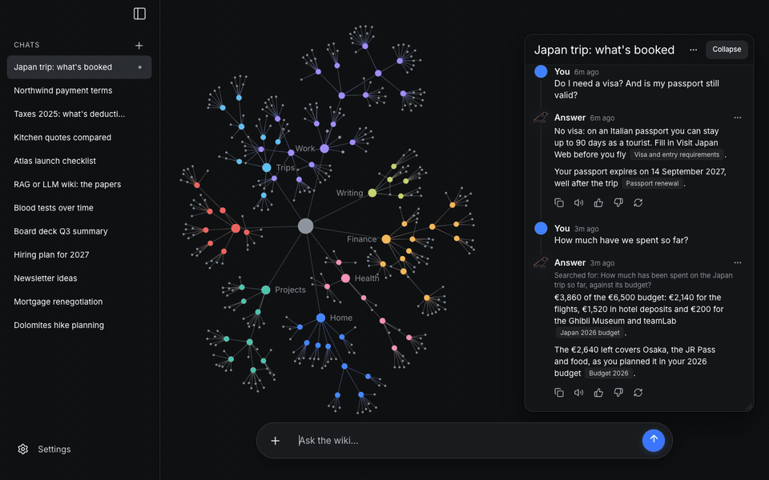
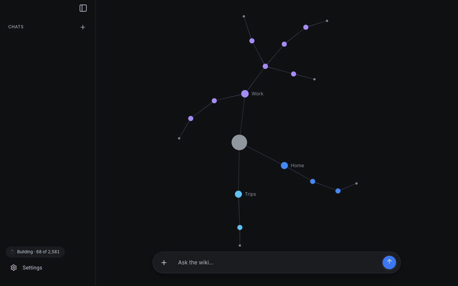
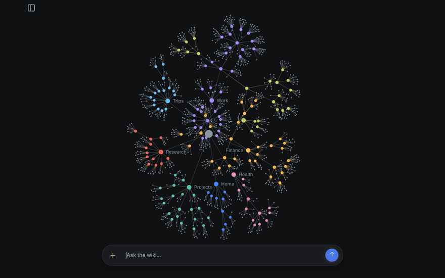
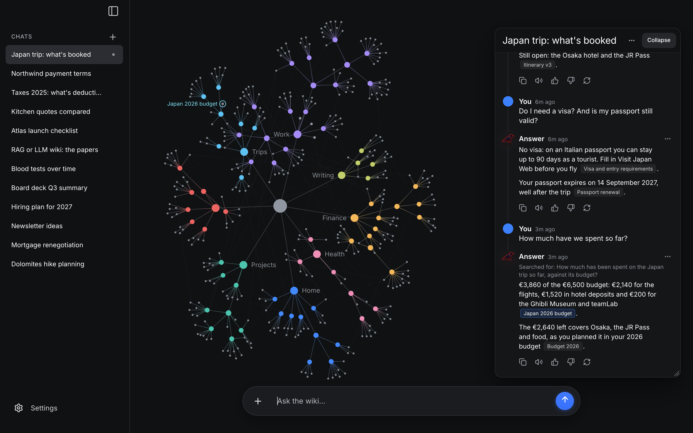
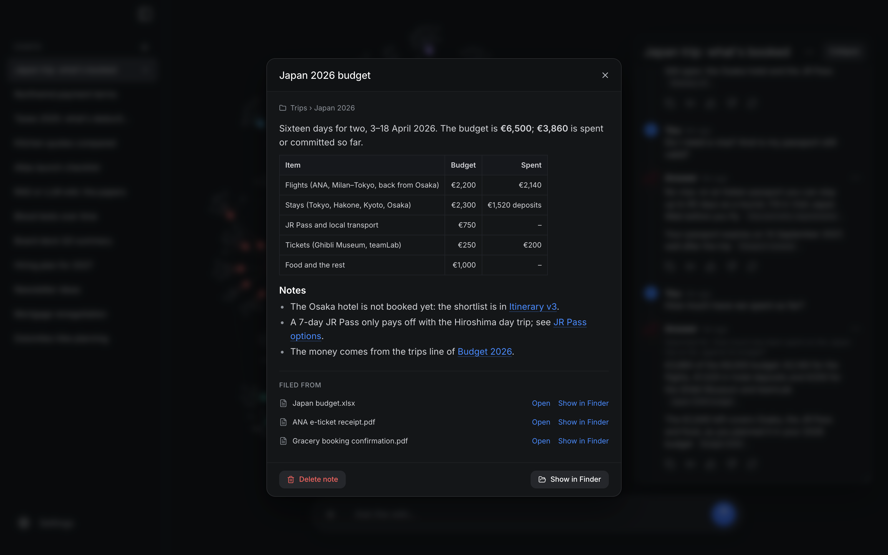
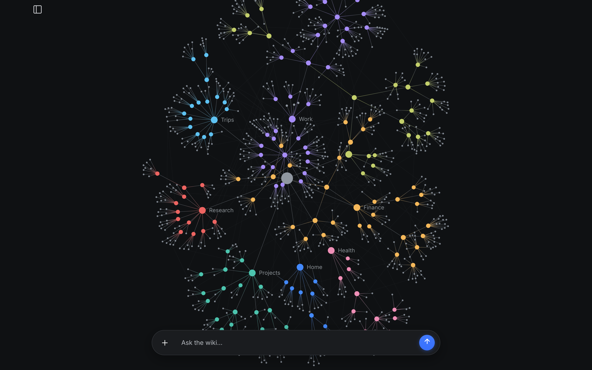
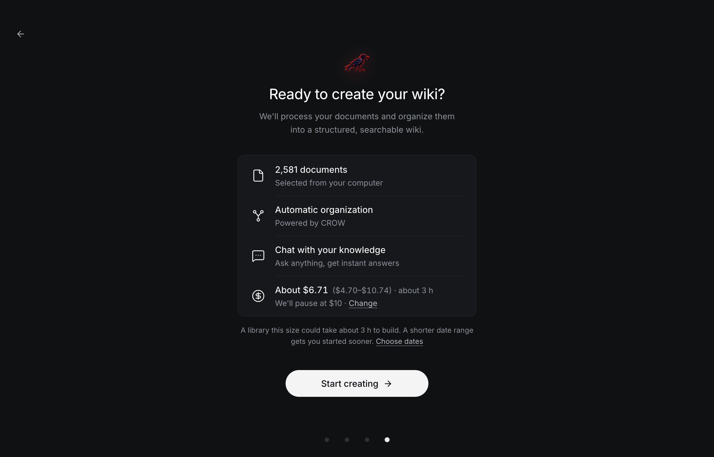
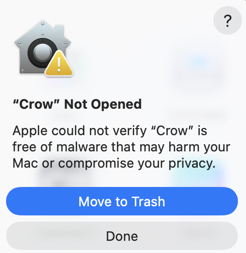
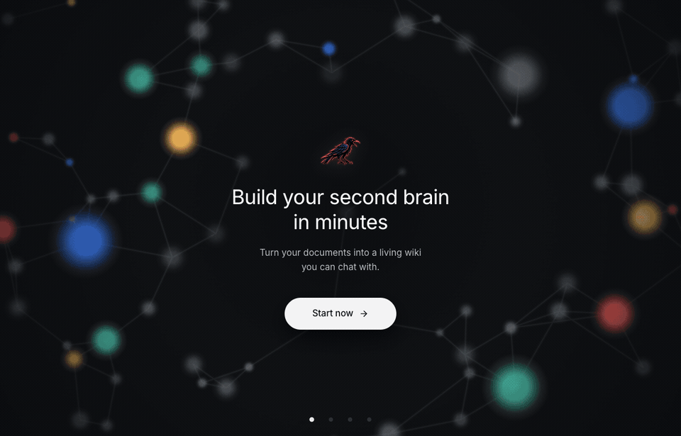

<!-- Copyright 2026 Federico Cesarini, Marco Sassarini. SPDX-License-Identifier: AGPL-3.0-or-later -->
<!-- Written by Crow's release workflow at every release: edits made here are overwritten. -->

<p align="center"></p>

<h1 align="center">Crow: an AI second brain built from the documents on your computer</h1>

<p align="center"><b>An LLM wiki you can chat with, for macOS, Windows and Linux.</b><br>
Crow finds your PDFs, Word files, slides and spreadsheets by itself, files them into a wiki of linked Markdown notes,<br>
and answers your questions citing the notes it used.</p>

<p align="center">
  <a href="#download"><b>Download Crow 0.1.3</b></a> ·
  <a href="#install-crow-the-builds-are-not-signed-yet">Install help for macOS and Windows</a> ·
  <a href="#faq">FAQ</a>
</p>

<p align="center"></p>

---

**Crow is a free desktop app that turns the documents already on your computer into a second brain: a wiki of
Markdown notes, filed by topic and linked to each other, that you can chat with.** It is the
[LLM wiki](https://gist.github.com/karpathy/442a6bf555914893e9891c11519de94f) idea Andrej Karpathy described, built for
thousands of documents and for people who would rather not use a terminal. It runs the CROW architecture of the
open-source [llm-wiki-v2](https://github.com/crow-hq/llm-wiki-v2) engine and works with any model on
[OpenRouter](https://openrouter.ai), through your own account.

## What Crow does

- **Finds your documents by itself.** Crow counts the documents in your home folder and shows where they live:
  Documents, Desktop, Downloads… You tick the folders (or a date range, or single files) and see the cost and the time
  before anything is spent.
- **Files them into a wiki that organizes itself.** Each document becomes a note in a folder about its subject. A new
  document on a subject updates the note already there instead of adding a copy, and a folder that grows is split into
  subfolders. Filing goes oldest first, so the newest facts win; files already filed, and duplicates, cost nothing again.
- **Lets you chat with your documents, with sources.** Answers cite the notes they come from, and those notes light up
  in the brain, the graph of everything you filed. Follow-up questions are understood in context.
- **Remembers.** A chat forgets when it ends; the wiki doesn't. Every document you add makes the notes you already
  have better, and you can drop a new file onto a folder of the brain to file it there.
- **Keeps it in plain Markdown you own.** The wiki is a folder of Markdown files on your computer, in Google's
  [Open Knowledge Format](https://github.com/GoogleCloudPlatform/open-knowledge-format): open it in Obsidian or any
  editor, back it up, keep it in git. Your documents are never changed or moved.
- **Works with any model, within a spending limit.** Gemini, Claude, DeepSeek or any model on OpenRouter. Crow pauses
  at your spending limit and continues where it stopped after a restart.

Crow reads PDF, Word (`.docx`), PowerPoint (`.pptx`), Excel (`.xlsx`), CSV, OpenDocument text and spreadsheets
(`.odt`, `.ods`), Markdown and plain text; a spreadsheet becomes a note per sheet. Scanned PDFs without a text layer are
skipped: Crow does no OCR yet.

## See it

<table>
<tr>
<td width="50%" valign="top"><br><b>The brain grows as Crow files.</b> Each document joins the folder of its subject, and a folder that grows splits into subfolders (sped up).</td>
<td width="50%" valign="top"><br><b>Folders inside folders.</b> Zoom in and the names appear, down to the notes; click a folder to dim everything else.</td>
</tr>
<tr>
<td valign="top"><br><b>Answers with sources.</b> Point at a cited note and it lights up in the brain; click it to read it.</td>
<td valign="top"><br><b>Notes you can read.</b> Plain Markdown, with the documents each note was filed from.</td>
</tr>
<tr>
<td valign="top"><br><b>One brain, every subject.</b> Hundreds of notes in nested folders, a colour per subject.</td>
<td valign="top"><br><b>The cost before you start,</b> from OpenRouter's prices and the size of each document.</td>
</tr>
</table>

The screenshots show a sample wiki made up for them. [All the screenshots](assets/screenshots).

## Download

Crow 0.1.3, released 19 October 2026:

| System | For | Download | Size |
|---|---|---|---|
| **macOS** | Apple silicon (M1 and later) | [Crow_0.1.3_aarch64.dmg](https://github.com/crow-hq/crow-desktop/releases/download/v0.1.3/Crow_0.1.3_aarch64.dmg) | 28 MB |
| **macOS** | Intel | [Crow_0.1.3_x64.dmg](https://github.com/crow-hq/crow-desktop/releases/download/v0.1.3/Crow_0.1.3_x64.dmg) | 30 MB |
| **Windows** | Installer (.exe) | [Crow_0.1.3_x64-setup.exe](https://github.com/crow-hq/crow-desktop/releases/download/v0.1.3/Crow_0.1.3_x64-setup.exe) | 27 MB |
| **Windows** | Installer for IT (.msi) | [Crow_0.1.3_x64_en-US.msi](https://github.com/crow-hq/crow-desktop/releases/download/v0.1.3/Crow_0.1.3_x64_en-US.msi) | 29 MB |
| **Linux** | AppImage, any distribution | [Crow_0.1.3_amd64.AppImage](https://github.com/crow-hq/crow-desktop/releases/download/v0.1.3/Crow_0.1.3_amd64.AppImage) | 111 MB |
| **Linux** | Debian, Ubuntu (.deb) | [Crow_0.1.3_amd64.deb](https://github.com/crow-hq/crow-desktop/releases/download/v0.1.3/Crow_0.1.3_amd64.deb) | 33 MB |
| **Linux** | Fedora, openSUSE (.rpm) | [Crow-0.1.3-1.x86_64.rpm](https://github.com/crow-hq/crow-desktop/releases/download/v0.1.3/Crow-0.1.3-1.x86_64.rpm) | 33 MB |

Every file of this version is on its [release page](https://github.com/crow-hq/crow-desktop/releases/tag/v0.1.3); older versions are under
[Releases](https://github.com/crow-hq/crow-desktop/releases). Crow gets new versions from here: Settings → About →
**Check for updates**.

## Install Crow (the builds are not signed yet)

Crow's installers are not signed with an Apple or Microsoft developer certificate yet, so macOS and Windows warn you
the first time you open it. That is expected for an unsigned app; here is how to open it. You do this once.

### macOS: "Crow" Not Opened

On macOS Sequoia, Tahoe and later:

1. Open the `.dmg` (Apple silicon for Macs with M1 or later, Intel for older ones) and drag **Crow** into
   **Applications**.
2. Open Crow from Applications. macOS says it could not verify Crow:

   

   Click **Done**, not Move to Trash.
3. Open **System Settings → Privacy & Security** and scroll down to **Security**. Next to *"Crow" was blocked to
   protect your Mac*, click **Open Anyway**, and confirm with your password or Touch ID.
4. macOS asks once more: click **Open**. From now on Crow opens with a double-click.

- No **Open Anyway** button? Open Crow again, then go straight back to Privacy & Security.
- Control-click → Open no longer skips this check since macOS Sequoia: use Privacy & Security.
- If macOS says Crow "is damaged and can't be opened", open Terminal, run
  `xattr -dr com.apple.quarantine /Applications/Crow.app`, and open Crow again.

Then macOS asks once per folder (Documents, Desktop, Downloads) before Crow may look into it: allow the folders you
want in your second brain.

### Windows: "Windows protected your PC"

On Windows 10 and 11:

1. Download `Crow_…_x64-setup.exe`. If Microsoft Edge says it *isn't commonly downloaded*, click **…** next to it →
   **Keep** → **Show more** → **Keep anyway**. In Chrome, click **Keep**.
2. Run it. When Microsoft Defender SmartScreen says *Windows protected your PC*, click **More info** → **Run anyway**.
3. Blocked with no **Run anyway** button? That is Smart App Control, which blocks every unsigned app on Windows 11 and
   has no exception for one app. You can turn it off in **Windows Security → App & browser control → Smart App
   Control settings**; on some Windows 11 versions it cannot be turned back on without reinstalling Windows, so decide
   with that in mind.

### Linux

- **AppImage**, any distribution: `chmod +x Crow_*.AppImage`, then `./Crow_*.AppImage` (or right-click → Properties →
  *Allow executing file as program*). If it doesn't start and mentions FUSE, install it: `sudo apt install libfuse2t64`
  on Ubuntu 24.04 and later, `sudo apt install libfuse2` on 22.04.
- **Debian, Ubuntu:** `sudo apt install ./Crow_*_amd64.deb`
- **Fedora, openSUSE:** `sudo dnf install ./Crow-*.x86_64.rpm` (or `sudo zypper install` on openSUSE)

## Start

1. Pick the folders Crow should read, or single files.
2. Press **Connect**: [OpenRouter](https://openrouter.ai) opens in your browser. Sign in (or make an account), press
   **Authorize**, and Crow gets a key of its own on your account. That page also lets you give the key a credit limit
   or an expiry; later, Settings → OpenRouter → **Manage this key on OpenRouter** opens it again, and **Sign out** makes
   Crow forget it.
3. Choose a model, check the cost, and start. You can chat with the wiki while it grows.

<p align="center"></p>

Already have an OpenRouter key? Crow also reads `OPENROUTER_API_KEY` from the environment, or from a `.env` file
(used when you have not signed in):

| System | `.env` file |
|---|---|
| macOS | `~/Library/Application Support/com.crowhq.crow/.env` |
| Windows | `%APPDATA%\com.crowhq.crow\.env` |
| Linux | `~/.config/com.crowhq.crow/.env` |

```
OPENROUTER_API_KEY=sk-or-v1-…
```

## Why a wiki and not RAG?

Most "chat with your PDFs" tools use RAG: they cut documents into chunks, keep them in a vector database, and look
them up again at every question. Crow writes the knowledge down instead, as Karpathy's LLM wiki does: each document is
read once, summarized into a note in the right folder, merged with what the wiki already knows and linked to related
notes. Answers read those notes and cite them, and you can open, correct and keep every one.

| | Crow (LLM wiki) | Typical "chat with PDF" tool (RAG) |
|---|---|---|
| Finding your documents | Crow finds them on your computer | You upload them |
| What you keep | Readable Markdown notes, filed and linked | A vector index no one reads |
| A new document on the same subject | Updates the note already there | Adds more chunks |
| Where it lives | A folder on your computer | Often a cloud service |

Karpathy's LLM wiki finds pages by having the model read an index, which works up to about a hundred sources. CROW
makes it scale: a small classifier picks each document's folder among every folder of the wiki, so the wiki keeps
growing without a vector database. In llm-wiki-v2's benchmarks, CROW found the right note 89% of the time against 62%
with an LLM making every decision, filed documents 2.1× faster and used 68% fewer LLM tokens; in the
[CROW paper](https://doi.org/10.5281/zenodo.22898752), retrieval kept its accuracy across a twentyfold growth of the
wiki. These are the authors' own measurements; the scripts are in
[llm-wiki-v2's benchmarks](https://github.com/crow-hq/llm-wiki-v2/tree/main/benchmarks).

## What it costs

Crow is free. You pay OpenRouter for the models it uses. Before filing starts, Crow estimates the cost from
OpenRouter's current prices and the real size of each document you picked, and it stops on its own at your spending
limit ($10 unless you change it). With the default model, a typical document costs a fraction of a cent; a library of
thousands takes hours, so start with a folder or a recent date range and add more later.

## Privacy

Privacy depends on OpenRouter and on the model you choose. Your wiki and your chats are stored only on your computer,
but what the models read goes to OpenRouter, which passes it on to each model's provider (the writer's and the
classifier's): to file a document, its text, its name, where it is on your computer and the notes it may join; to
answer a question, the question, the notes the answer draws on and the chat's earlier messages. What they keep, for
how long, and whether they may train on it is up to [OpenRouter's privacy policy](https://openrouter.ai/privacy) and to
each provider's own ([OpenRouter lists them](https://openrouter.ai/docs/guides/privacy/provider-logging)), which Crow
does not control. Your [privacy settings on OpenRouter](https://openrouter.ai/settings/privacy) let you turn away
providers that train on prompts. Choose the model with this in mind, and keep what you would not share out of the
folders you pick.

## FAQ

### What is a second brain?

A second brain is a system outside your head that keeps what you read and learn, so you can find it and connect it
later. Crow builds one from the documents you already have: you don't write, tag or file anything yourself.

### What is an LLM wiki?

An LLM wiki is a set of Markdown pages that a language model writes and keeps up to date from your sources, an idea
Andrej Karpathy [described](https://gist.github.com/karpathy/442a6bf555914893e9891c11519de94f) in 2026. Instead of
searching your documents again at every question, the model reads each source once and files what it says. Crow is a
desktop app that builds one from your files and keeps it organized as it grows to thousands of documents.

### How do I chat with thousands of PDFs and documents on my computer?

Install Crow, tick the folders that hold them, and start: Crow files them into the wiki, oldest first, and you can ask
questions while it works. Each answer names the notes it used, so you can open them and check.

### Can I use it with Obsidian?

Yes. The wiki is a folder of Markdown files with relative links and an `index.md` in every folder, so Obsidian opens
it as a vault, graph view included. Settings → Library → **Show in Finder/Explorer** shows where it is. Crow doesn't
need Obsidian.

### Does Crow change, move or upload my files?

It never changes or moves them: Crow reads the folders you choose and keeps a copy of each document's text inside the
wiki. Deleting a note, or resetting Crow, never touches your documents. To file a document, its text goes to the model
you chose through OpenRouter (see [Privacy](#privacy)).

### Which AI models can I use? Can I run it offline or with Ollama?

Gemini 3.8 Flash (the default), Claude Sonnet 5.5, DeepSeek V4.1 Flash, or any other model on OpenRouter, under
Advanced settings; a small classifier model, Jev, decides where each document goes. Crow works through OpenRouter, so
it needs an internet connection; local models are not supported in the app yet. The
[llm-wiki-v2](https://github.com/crow-hq/llm-wiki-v2) engine runs with Ollama from the command line.

### Can my AI agents use the wiki as memory?

The wiki is plain Markdown with an index in every folder, so any agent that reads files (Claude Code, Codex, Cursor
and the like) can use it as long-term memory, and the [llm-wiki-v2](https://github.com/crow-hq/llm-wiki-v2) engine can
serve the same wiki over HTTP.

### How is Crow different from NotebookLM?

NotebookLM works on the sources you upload to it, notebook by notebook, in Google's cloud. Crow finds the documents on
your computer by itself and writes one wiki of Markdown files that stays on your computer, which you can read, edit and
keep, with the models you choose through OpenRouter.

### Why does my Mac or PC say Crow can't be verified?

Because Crow's installers are not signed with a paid Apple or Microsoft developer certificate yet. The warning is
expected; [Install Crow](#install-crow-the-builds-are-not-signed-yet) shows how to open it.

## Something wrong?

- **Logs:** Settings → About → **Open logs**.
- **The wiki itself:** Settings → Library → **Show in Finder/Explorer**, or right-click the brain's empty space. It is
  a plain folder of Markdown files ([the format](https://github.com/crow-hq/llm-wiki-v2#the-wiki-on-disk)).
- **Start over:** Settings → Library → **Reset Crow…** erases the wiki, the chats and the settings, and Crow starts
  from its first screen. Your documents stay where they are.
- **Linux, a blank window:** start Crow with `WEBKIT_DISABLE_DMABUF_RENDERER=1`.
- **Bugs and ideas:** [issues](https://github.com/crow-hq/crow-desktop/issues).

## Credits and license

Crow is by Federico Cesarini and Marco Sassarini, the authors of
[llm-wiki-v2](https://github.com/crow-hq/llm-wiki-v2) and of the CROW paper: F. Cesarini, M. Sassarini, *CROW:
Classifier-Routed Organization of LLM Wikis*, 2026, [doi:10.5281/zenodo.22898752](https://doi.org/10.5281/zenodo.22898752).
The LLM wiki idea is Andrej Karpathy's ([LLM Wiki](https://gist.github.com/karpathy/442a6bf555914893e9891c11519de94f),
2026), and the wiki format derives from Google's
[Open Knowledge Format](https://github.com/GoogleCloudPlatform/open-knowledge-format). Crow is licensed under the GNU
AGPL v3.0 or later; every installer carries the licence and the notices of the components it ships.
